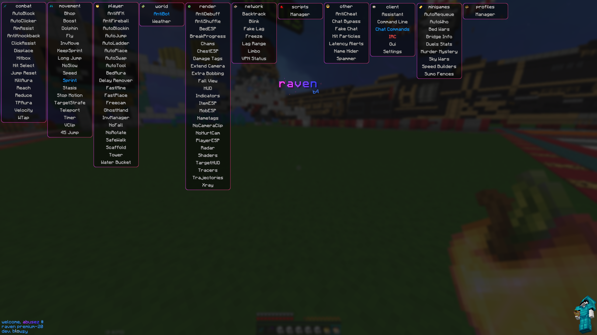

## Open B4

---

<div align="center">
  
</div>

## Changes

- Removed all API calls and backend references
- Spoof UID #1

## Building

```powershell
.\gradlew.bat build
```

## Decrypting Scripts - u20

Raven's protected scripts carry two recovered layers:

1. **AES-128/ECB** — key `K8ai@rUb^mj7X91P`, applied to the Base64 in a `decrypt - "<base64>"` line.
2. **Hex/XOR chain** — a 16-byte key table and a shift constant of `73`. The first two hex digits
   seed the chain and the rest are the data bytes.

The plaintext keeps a 32-character trailer, and the client stamps the formula it contains with the
user's UID: `size * 0.05506` becomes `size * 0.05` + the UID.

## Credits

- Sande: Finding an undetected way to dump and providing the dump
- Abusez: Deobfuscating/Recovering
- Mega: Deobfuscating/Recovering
- Chef: Making Raven B4
